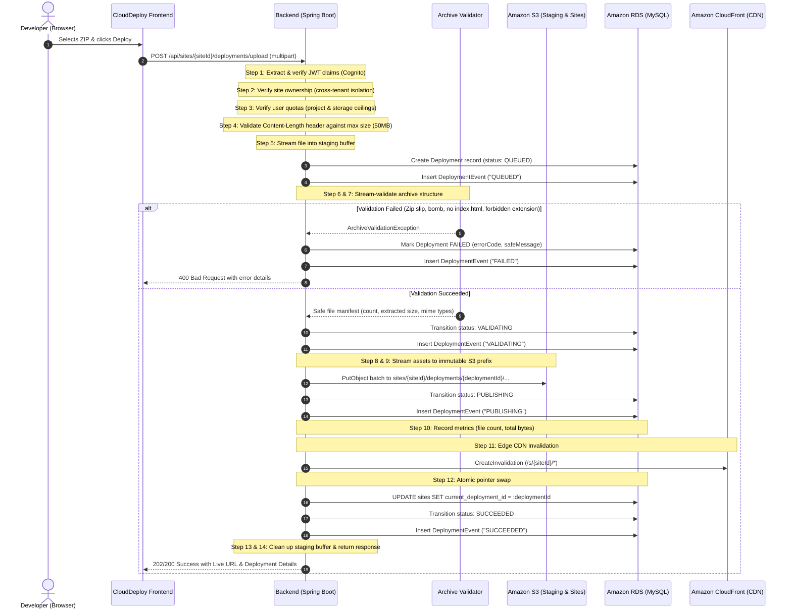
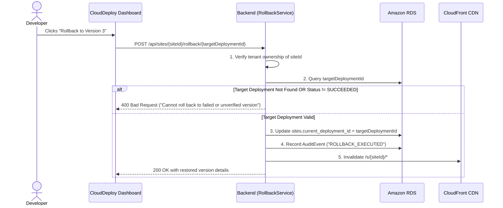

# CloudDeploy Deployment & Rollback Engine Workflow

## 1. Pipeline Principles
The CloudDeploy deployment engine is an idempotent, fail-safe orchestrator designed to publish customer static websites safely to AWS without ever exposing backend compute to untrusted code execution.

- **Atomicity**: The active live version of a site (`site.currentDeploymentId`) is updated **only after** all assets are safely written to S3 and verified.
- **Fail-Safe Integrity**: A deployment failure never impacts an existing live version.
- **Immutable Storage**: Each deployment receives a globally unique prefix (`sites/{siteId}/deployments/{deploymentId}/`). Files from previous versions are never overwritten in-place.
- **Full Traceability**: Every transition records discrete diagnostic timestamps in `deployment_events`.

---

## 2. The 14-Step Deployment Pipeline



---

## 3. Detailed Step-by-Step Breakdown

### Step 1: Cryptographic Authentication
The request's `Authorization: Bearer <token>` is validated by `JwtAuthFilter`. The caller's Cognito `sub` is verified against the JWKS endpoint. Unauthenticated calls are rejected with HTTP 401.

### Step 2: Tenant Ownership Verification
The engine queries the `sites` repository using both `siteId` and the authenticated user's database ID:
```java
Site site = siteRepository.findByIdAndOwnerId(siteId, currentUser.getId())
    .orElseThrow(() -> new UnauthorizedException("Access denied: You do not own this site."));
```
Attempting to deploy against another user's project yields HTTP 403 Forbidden.

### Step 3: Quota & Storage Ceilings
The engine aggregates active storage across all of the user's projects. If total storage exceeds `maxStorageBytes` (e.g. 1GB) or if user project count exceeds plan limits, the upload is rejected immediately before saving:
```java
if (currentUsage + uploadSize > maxStorageAllowed) {
    throw new QuotaExceededException("Account storage limit exceeded.");
}
```

### Step 4: Upload Size Enforcement
Incoming request stream lengths are strictly checked against `app.upload.max-bytes` (default: 52,428,800 bytes / 50 MB). Oversized payloads are aborted before full disk buffering.

### Step 5: Controlled Ingestion
The raw ZIP is written to an ephemeral staging location or temporary buffer. The file is assigned an isolated `uploadId` (`upl_xxxx`).

### Step 6: Safe Streaming Inspection
The backend inspects the ZIP entry by entry using Java's `ZipInputStream`. The stream is processed sequentially to prevent loading the entire uncompressed archive into heap memory.

### Step 7: Multi-Vector Security Validation
The `ArchiveValidator` applies 7 deterministic checks:
1. **ZIP Slip & Path Traversal Prevention**: Every entry path is normalized. Any entry starting with `/`, containing `..`, or resolving outside the intended extraction root is instantly rejected.
2. **Decompression Bomb Detection**:
   - Total uncompressed size accumulator is capped at `app.validation.max-extracted-bytes` (default: 250 MB).
   - Compression ratio threshold: If uncompressed size exceeds 100x the compressed size, processing halts.
3. **File Count Throttling**: The archive must not contain more than `app.validation.max-files-per-deployment` (default: 1,000 files).
4. **Root Entrypoint Requirement**: The archive root must contain an `index.html` file. Archives where index.html is buried within nested folders without a root index are rejected with clear user guidance.
5. **Executable & Malicious Extension Denylist**:
   Files with extensions such as `.exe`, `.dll`, `.sh`, `.bat`, `.cmd`, `.py`, `.php`, `.rb`, `.cgi`, `.jar`, `.war` are rejected with `ARCHIVE_VALIDATION_ERROR`.
6. **Zero-Byte / Empty Archive Check**: Archives with 0 files are rejected.
7. **Symlink and Absolute Path Block**: Any entry identified as a symbolic link or containing absolute POSIX or Windows drive prefixes (`C:\`) is blocked.

### Step 8: Controlled Staging
Validated files are written only to a strictly sandboxed, auto-deleting temporary directory on the host instance or streamed directly to S3 via reactive multipart upload.

### Step 9: S3 Origin Publishing
Files are synchronized to the published sites S3 bucket under the immutable version prefix:
```
sites/{siteId}/deployments/{deploymentId}/{assetRelativePath}
```
Each object is published with:
- Proper MIME type detection (`text/html`, `text/css`, `application/javascript`, `image/webp`, `font/woff2`, etc.).
- Explicit cache headers:
  - `index.html`: `Cache-Control: public, max-age=0, must-revalidate` (ensures browsers always fetch the freshest entrypoint).
  - Static hashed assets (`.js`, `.css`, images): `Cache-Control: public, max-age=31536000, immutable`.
- Server-side encryption: AES-256 (`aws:kms` or `AES256`).

### Step 10: Metadata Persistence in Amazon RDS
The deployment record in RDS is updated with:
- `file_count`: Exact count of published assets.
- `total_size_bytes`: Verified uncompressed byte count.
- `s3_deployment_prefix`: Exact S3 directory.
- `status`: Updated to `PUBLISHING`.

### Step 11: CloudFront Invalidation
The orchestrator dispatches an AWS CloudFront Invalidation request to the sites distribution:
- Target paths: `/s/{siteId}/*`
- Caller reference: `inval_{deploymentId}_{timestamp}`
This purges edge caches across all 600+ CloudFront Points of Presence worldwide within seconds.

### Step 12: Atomic Live Reference Swap
The target site record in RDS is updated in an atomic database transaction:
```sql
UPDATE sites 
SET current_deployment_id = :deploymentId, 
    updated_at = NOW() 
WHERE site_id = :siteId;
```
Only at this instant does the platform consider the new version live.

### Step 13: Final State & Live URL Generation
The deployment status transitions to `SUCCEEDED`. The engine generates the deterministic live URL:
`https://sites.clouddeploy.io/s/{siteId}/` (or the configured CloudFront domain).

### Step 14: Ephemeral Resource Cleanup
Temporary files and staging ZIP buffers on disk are purged in a `finally` block, ensuring zero residual disk leaks on compute instances.

---

## 4. Rollback Workflow

When a user initiates a rollback from the CloudDeploy dashboard:



### Key Rollback Guarantees:
1. **Zero Asset Re-Upload**: Since previous versions remain intact in S3 under their immutable deployment prefixes (`sites/{siteId}/deployments/{deploymentId}/`), a rollback requires **no re-extraction or re-uploading**.
2. **Instant Reversion**: Rollback executes in ~300ms (database pointer update + edge cache invalidation).
3. **Safety Gate**: The engine explicitly refuses to roll back to any deployment that is `FAILED`, `QUEUED`, or `VALIDATING`.
